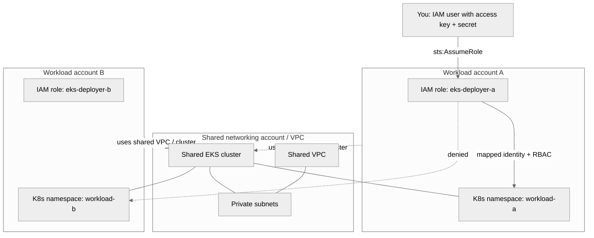
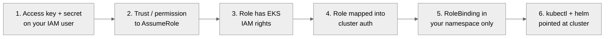
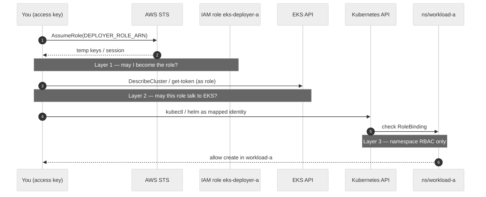
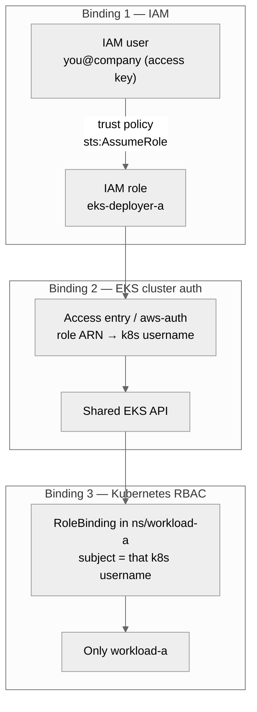
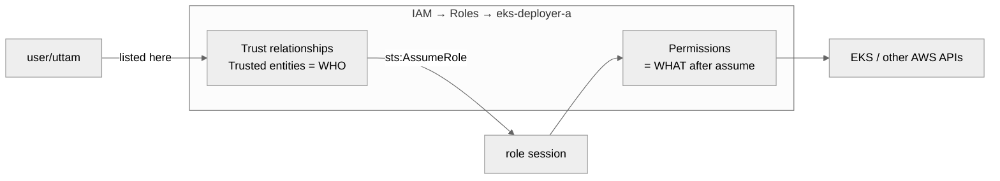
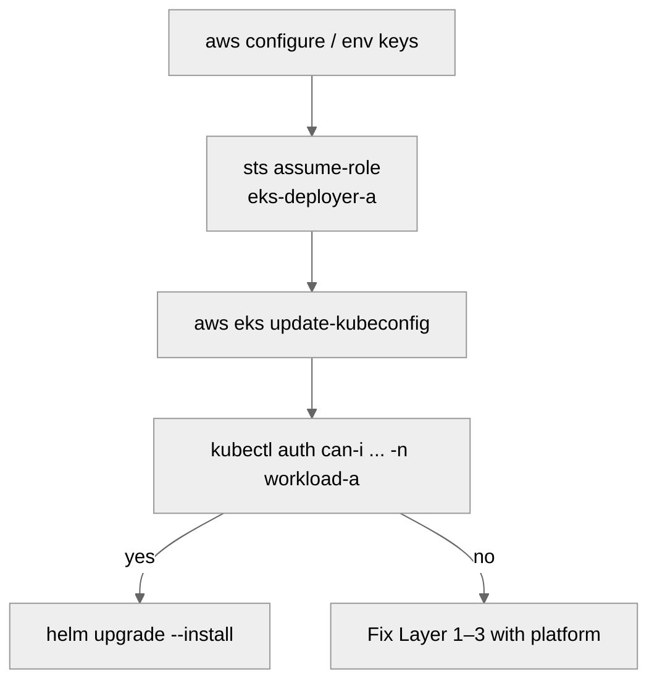
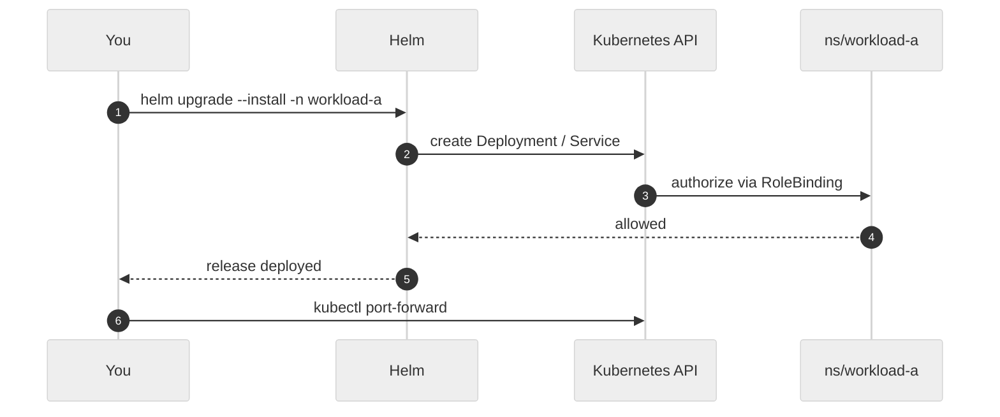

# AWS: Shared EKS namespace access + Helm (hello-world)

AWS-only runbook. Parallel to the GCP shared-GKE design: **one shared EKS
cluster** on a **shared VPC**, with **one Kubernetes namespace per workload
account**. You have an IAM **access key + secret key** and need to deploy with
Helm into **your** namespace only.

> Diagrams use Mermaid (renders in GitHub / many Markdown viewers).

---

## Target layout (what already exists)



| Piece | Typical owner | Notes |
|---|---|---|
| Shared VPC + subnets | Network / platform account | EKS nodes + pods use these |
| Shared EKS cluster | Platform account | One cluster, many tenants |
| Namespace `workload-a` | Your app account’s tenancy | Soft isolation via RBAC |
| IAM role `eks-deployer-a` | Your workload account (or platform) | What you **AssumeRole** into |

---

## What you need before you can login

Having an access key is **not enough**. All of the following must be true.



### Checklist

| # | Requirement | Why |
|---|---|---|
| 1 | IAM **access key ID** + **secret access key** (or SSO profile) | Authenticates *you* |
| 2 | Permission to call `sts:AssumeRole` on the **deployer role ARN** | Becomes the identity EKS trusts |
| 3 | Deployer role has EKS access (e.g. `eks:DescribeCluster`, and is in `aws-auth` / EKS access entries) | Can get kubeconfig / call API |
| 4 | Cluster auth maps that role → Kubernetes username/groups | API knows who you are |
| 5 | **Role** + **RoleBinding** in namespace `workload-a` only | Helm works there; other namespaces Forbidden |
| 6 | Tools: `aws` CLI, `kubectl`, `helm`, and network path to the API (VPN / bastion / public endpoint if allowed) | Client side |

### Values you must know (ask platform / copy from docs)

```text
AWS_ACCESS_KEY_ID=...
AWS_SECRET_ACCESS_KEY=...
AWS_DEFAULT_REGION=us-east-1

DEPLOYER_ROLE_ARN=arn:aws:iam::111122223333:role/eks-deployer-a
EKS_CLUSTER_NAME=shared-eks-dev
EKS_CLUSTER_ACCOUNT=999988887777          # account that owns the cluster (if different)
NAMESPACE=workload-a
```

Cross-account note: if EKS lives in another account, the deployer role still
needs to be **mapped in that cluster**, and your user needs to AssumeRole into
that role (trust policy allows your user/account).

---

## Three layers (same idea as GCP Token Creator)



| Layer | AWS check | Failure symptom |
|---|---|---|
| 1 | Trust policy + `sts:AssumeRole` | `AccessDenied` on AssumeRole |
| 2 | EKS IAM + access entry / `aws-auth` | Cannot get token / Unauthorized to cluster |
| 3 | Namespace RoleBinding | `Forbidden` on `helm -n workload-a` |

---

## The three bindings (example code)

In short: **create a role** → **say who can assume it** → **map that role into
the EKS cluster** → **RoleBind it to one namespace**.



Placeholder IDs used below:

| Placeholder | Example |
|---|---|
| Your user | `arn:aws:iam::111122223333:user/uttam` |
| Deployer role | `arn:aws:iam::111122223333:role/eks-deployer-a` |
| Cluster | `shared-eks-dev` in account `999988887777` |
| Namespace | `workload-a` |

### Binding 1 — Create the role + who can assume it

Platform/app account creates the role. The **trust policy** is the allowlist
(same idea as GCP `impersonators` + Token Creator).

```hcl
# Example Terraform (IAM)

resource "aws_iam_role" "eks_deployer_a" {
  name = "eks-deployer-a"

  # WHO may assume this role
  assume_role_policy = jsonencode({
    Version = "2012-10-17"
    Statement = [{
      Effect = "Allow"
      Principal = {
        AWS = "arn:aws:iam::111122223333:user/uttam"
        # or a whole account / SSO role:
        # AWS = "arn:aws:iam::111122223333:root"
      }
      Action = "sts:AssumeRole"
    }]
  })
}

# What the role can do in AWS APIs (describe cluster, get token helpers, etc.)
resource "aws_iam_role_policy" "eks_deployer_a_eks" {
  name = "eks-read-cluster"
  role = aws_iam_role.eks_deployer_a.id

  policy = jsonencode({
    Version = "2012-10-17"
    Statement = [{
      Effect = "Allow"
      Action = [
        "eks:DescribeCluster",
        "eks:ListClusters"
      ]
      Resource = "arn:aws:eks:us-east-1:999988887777:cluster/shared-eks-dev"
    }]
  })
}
```

Your IAM user also needs permission to call AssumeRole (inline/group policy):

```json
{
  "Version": "2012-10-17",
  "Statement": [{
    "Effect": "Allow",
    "Action": "sts:AssumeRole",
    "Resource": "arn:aws:iam::111122223333:role/eks-deployer-a"
  }]
}
```

Without this binding: `AccessDenied` on `aws sts assume-role`.

#### AWS Console: where “who can assume it” shows

Yes — that is the role’s **Trusted entities** (also called **Trust relationships**).

Path:

1. AWS Console → **IAM** → **Roles** → open `eks-deployer-a`
2. Tab **Trust relationships** (older UI) / trusted entities summary at top
3. You see the principals allowed to call `sts:AssumeRole` on this role
4. Click **Edit trust policy** to see the raw JSON (same as Terraform `assume_role_policy`)

What you are looking at:

| Console label | Meaning |
|---|---|
| **Trusted entities** | Who may assume this role |
| **Permissions** | What the role can do *after* it is assumed |
| **Trust relationships** JSON | The actual allowlist policy |

Example of what the console shows for a single user:

```text
Trusted entities
  AWS
    arn:aws:iam::111122223333:user/uttam
```

Same thing as JSON in **Edit trust policy**:

```json
{
  "Version": "2012-10-17",
  "Statement": [
    {
      "Effect": "Allow",
      "Principal": {
        "AWS": "arn:aws:iam::111122223333:user/uttam"
      },
      "Action": "sts:AssumeRole"
    }
  ]
}
```

Other common trusted-entity shapes:

```json
// Whole account (any principal in that account that is also allowed to AssumeRole)
"Principal": { "AWS": "arn:aws:iam::111122223333:root" }

// Another role (e.g. SSO / CI role)
"Principal": { "AWS": "arn:aws:iam::111122223333:role/AWSReservedSSO_Admin_xxxxx" }

// Multiple users
"Principal": {
  "AWS": [
    "arn:aws:iam::111122223333:user/uttam",
    "arn:aws:iam::111122223333:user/alice"
  ]
}
```



Important: being in **Trusted entities** is required but not always enough — your
user/group must also have an identity policy allowing `sts:AssumeRole` on that
role ARN (see JSON above). Console trust tab = “role accepts you”; your user
policy = “you are allowed to call AssumeRole”.

### Binding 2 — Bind / map the role to the EKS cluster

EKS must recognize the **role ARN** as a Kubernetes identity. Prefer **EKS
access entries** (modern). Older clusters use the `aws-auth` ConfigMap.

**Option A — EKS access entry (recommended)**

```hcl
# Run in the account that owns the cluster

resource "aws_eks_access_entry" "deployer_a" {
  cluster_name  = "shared-eks-dev"
  principal_arn = "arn:aws:iam::111122223333:role/eks-deployer-a"
  type          = "STANDARD"
  # Kubernetes username derived from the role unless you set user_name
}

# Grant API access at cluster scope (still limit with namespace RBAC below).
# Use a narrow policy if your platform defines one; AmazonEKSViewPolicy is too
# weak for helm install — platform often uses a custom Access Policy or
# leaves cluster auth open then relies on namespace RoleBindings.
resource "aws_eks_access_policy_association" "deployer_a" {
  cluster_name  = aws_eks_access_entry.deployer_a.cluster_name
  principal_arn = aws_eks_access_entry.deployer_a.principal_arn
  policy_arn    = "arn:aws:eks::aws:cluster-access-policy/AmazonEKSClusterAdminPolicy"
  # Better in prod: custom / namespace-scoped access policy if available,
  # or a weaker cluster policy + strong namespace RoleBinding only.

  access_scope {
    type = "cluster"
  }
}
```

For a tighter platform setup, map the role with **no** broad cluster admin
policy and rely on Kubernetes RoleBindings (Binding 3) after the identity
exists in the cluster.

**Option B — classic `aws-auth` ConfigMap**

```yaml
# kubectl -n kube-system edit configmap aws-auth
apiVersion: v1
kind: ConfigMap
metadata:
  name: aws-auth
  namespace: kube-system
data:
  mapRoles: |
    - rolearn: arn:aws:iam::111122223333:role/eks-deployer-a
      username: eks-deployer-a
      groups:
        - workload-a-deployers
```

Without this binding: AssumeRole works, but kubectl gets `Unauthorized` /
cannot talk to the cluster.

### Binding 3 — Bind that identity to one namespace (Helm scope)

Create namespace RBAC so the mapped username/group can manage **only**
`workload-a`.

```yaml
apiVersion: v1
kind: Namespace
metadata:
  name: workload-a
---
apiVersion: rbac.authorization.k8s.io/v1
kind: Role
metadata:
  name: workload-a-edit
  namespace: workload-a
rules:
  - apiGroups: ["", "apps", "batch", "networking.k8s.io"]
    resources: ["*"]
    verbs: ["*"]
---
apiVersion: rbac.authorization.k8s.io/v1
kind: RoleBinding
metadata:
  name: workload-a-deployer
  namespace: workload-a
roleRef:
  apiGroup: rbac.authorization.k8s.io
  kind: Role
  name: workload-a-edit
subjects:
  # Match Binding 2 username (access entry / aws-auth)
  - kind: User
    name: eks-deployer-a
  # OR if you used a group in aws-auth:
  # - kind: Group
  #   name: workload-a-deployers
```

Without this binding: you reach the cluster but `helm -n workload-a` returns
`Forbidden`. Other namespaces stay denied — that is intentional.

### End-to-end picture

| Step | What | Example |
|---|---|---|
| Create role | `aws_iam_role.eks_deployer_a` | Role ARN exists |
| Who can assume | Trust policy principal = your user | Only you (or listed principals) |
| Map to cluster | Access entry / `aws-auth` | Role → `eks-deployer-a` in K8s |
| Namespace bind | RoleBinding in `workload-a` | That user can helm only there |
| You operate | Access key → AssumeRole → helm | Session acts as the role |

```text
you (access key)
  --AssumeRole-->  eks-deployer-a          (Binding 1: trust)
  --mapped------>  k8s user eks-deployer-a (Binding 2: cluster)
  --RoleBinding->  ns/workload-a only      (Binding 3: RBAC)
```

Same pattern on GCP: SA + Token Creator allowlist + `container.developer` +
namespace RoleBinding (see [AWS vs GCP impersonation](AWS-ASSUME-VS-GCP-IMPERSONATE.md)).

---

## Login steps (access key → namespace)

### 1. Configure the AWS CLI with your keys

```bash
export AWS_ACCESS_KEY_ID="AKIA..."
export AWS_SECRET_ACCESS_KEY="..."
export AWS_DEFAULT_REGION="us-east-1"

aws sts get-caller-identity
# confirm: your IAM user ARN
```

Or use a named profile in `~/.aws/credentials`.

### 2. Assume the deployer role

```bash
export DEPLOYER_ROLE_ARN="arn:aws:iam::111122223333:role/eks-deployer-a"

CREDS=$(aws sts assume-role \
  --role-arn "${DEPLOYER_ROLE_ARN}" \
  --role-session-name "helm-dev-$(whoami)" \
  --duration-seconds 3600 \
  --query 'Credentials' \
  --output json)

export AWS_ACCESS_KEY_ID=$(echo "$CREDS" | jq -r .AccessKeyId)
export AWS_SECRET_ACCESS_KEY=$(echo "$CREDS" | jq -r .SecretAccessKey)
export AWS_SESSION_TOKEN=$(echo "$CREDS" | jq -r .SessionToken)

aws sts get-caller-identity
# confirm: AssumedRole ... eks-deployer-a
```

Optional helper (same idea):

```bash
# ~/.aws/config
# [profile eks-deployer-a]
# role_arn = arn:aws:iam::111122223333:role/eks-deployer-a
# source_profile = my-user
# region = us-east-1
#
# export AWS_PROFILE=eks-deployer-a
```

### 3. Point kubectl at the shared cluster

```bash
export EKS_CLUSTER_NAME="shared-eks-dev"

aws eks update-kubeconfig \
  --name "${EKS_CLUSTER_NAME}" \
  --region "${AWS_DEFAULT_REGION}"
  # add --role-arn "${DEPLOYER_ROLE_ARN}" if kubeconfig should assume for you

kubectl config current-context
kubectl auth can-i create deployments -n workload-a   # yes
kubectl auth can-i list pods -n workload-b            # no / forbidden
```



---

## Sample Helm chart: hello-world

Create a tiny chart locally (no cluster changes until you install).

```bash
mkdir -p ~/charts && cd ~/charts
helm create hello-world
# Optional: strip extras — keep Deployment + Service only for a demo
```

Minimal values override (`hello-world/values-dev.yaml`):

```yaml
replicaCount: 1

image:
  repository: nginxinc/nginx-unprivileged
  tag: "1.27"
  pullPolicy: IfNotPresent

service:
  type: ClusterIP
  port: 8080

resources:
  requests:
    cpu: 50m
    memory: 64Mi
  limits:
    cpu: 200m
    memory: 128Mi

# Keep the chart in YOUR namespace only — never install without -n
```

Trimmed Deployment idea (if you edit templates): one container, port 8080,
no Ingress required for first smoke test.

---

## Deploy with Helm into your namespace

```bash
export NAMESPACE=workload-a
export RELEASE=hello-world

# Still using assumed-role credentials from above
helm upgrade --install "${RELEASE}" ./hello-world \
  --namespace "${NAMESPACE}" \
  --create-namespace=false \
  -f ./hello-world/values-dev.yaml \
  --wait --timeout 3m

kubectl -n "${NAMESPACE}" get deploy,po,svc
kubectl -n "${NAMESPACE}" rollout status deploy/"${RELEASE}"
```

Port-forward smoke test:

```bash
kubectl -n "${NAMESPACE}" port-forward svc/"${RELEASE}" 8080:8080
# browser or: curl -sS http://127.0.0.1:8080/ | head
```

Uninstall:

```bash
helm uninstall "${RELEASE}" -n "${NAMESPACE}"
```



---

## Common failures

| Symptom | Likely missing piece |
|---|---|
| `AccessDenied` on `assume-role` | Trust policy / your user not allowed (Layer 1) |
| `Unauthorized` / cannot describe cluster | Role not in EKS access entries / `aws-auth` (Layer 2) |
| `Forbidden` creating Deployments | No RoleBinding in your namespace (Layer 3) |
| Works in `workload-a`, fails in `workload-b` | **Expected** — other tenant isolation |
| Timeout reaching API server | Need VPN / bastion / correct endpoint access |

---

## Security notes

- Prefer **short-lived AssumeRole sessions**; do not put long-lived keys on shared laptops.
- Do **not** request cluster-admin; platform should only bind your role to **your** namespace.
- `--create-namespace=false` avoids accidentally creating namespaces if your RBAC is wider than intended.
- Access key + secret identify **you**; the **role** is what the cluster trusts for Helm.

---

## Quick copy-paste session

```bash
# 0) fill these
export AWS_ACCESS_KEY_ID="AKIA..."
export AWS_SECRET_ACCESS_KEY="..."
export AWS_DEFAULT_REGION="us-east-1"
export DEPLOYER_ROLE_ARN="arn:aws:iam::ACCOUNT:role/eks-deployer-a"
export EKS_CLUSTER_NAME="shared-eks-dev"
export NAMESPACE="workload-a"

# 1) assume role
CREDS=$(aws sts assume-role --role-arn "$DEPLOYER_ROLE_ARN" \
  --role-session-name "helm-$(whoami)" --query Credentials --output json)
export AWS_ACCESS_KEY_ID=$(echo "$CREDS" | jq -r .AccessKeyId)
export AWS_SECRET_ACCESS_KEY=$(echo "$CREDS" | jq -r .SecretAccessKey)
export AWS_SESSION_TOKEN=$(echo "$CREDS" | jq -r .SessionToken)

# 2) kubeconfig
aws eks update-kubeconfig --name "$EKS_CLUSTER_NAME" --region "$AWS_DEFAULT_REGION"

# 3) chart + deploy
cd ~/charts
helm create hello-world   # once
helm upgrade --install hello-world ./hello-world -n "$NAMESPACE" --wait

# 4) verify
kubectl -n "$NAMESPACE" get pods
kubectl auth can-i list pods -n other-tenant   # expect no
```

---

## Related (GCP twin)

For the same pattern on Google Cloud (impersonate SA → GKE namespace → helm),
see [AWS AssumeRole vs GCP impersonation](AWS-ASSUME-VS-GCP-IMPERSONATE.md) and
[Design: workload-dev + shared GKE](DESIGN-WORKLOAD-DEV-GKE.md).
