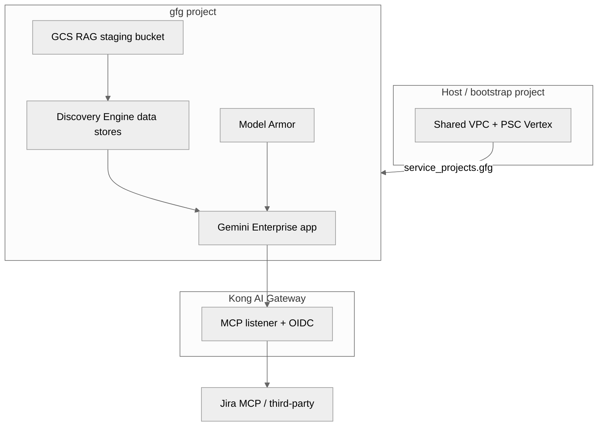

# Design: `gfg` workload — Gemini for Enterprise + MCP governance

**Workload ID:** `gfg`  
**Terraform module:** [tfe-workspace/workloads/gfg/](../tfe-workspace/workloads/gfg/)  
**Resource & method catalog:** [tfe-workspace/workloads/gfg/README.md](../tfe-workspace/workloads/gfg/README.md)  
**Enable in dev:** [tfe-workspace/envs/dev/workload-gfg.tf](../tfe-workspace/envs/dev/workload-gfg.tf) → `enabled = true`

**Description:** Gemini Enterprise app: Discovery Engine data stores, GCS document RAG, Model Armor, custom MCP via Kong AI Gateway (Jira and third-party tools), central OIDC.

Architecture diagrams: [GEMINI-ENTERPRISE-KONG-MCP-OIDC.md](GEMINI-ENTERPRISE-KONG-MCP-OIDC.md).

---

## Folder layout (separate from `workload-dev`)

```text
tfe-workspace/
  workloads/
    README.md           # workload pattern
    gfg/                # THIS workload
      main.tf
      variables.tf
      outputs.tf
      README.md         # all Terraform resources + operational methods
    workload-dev/       # other tenant workload
  envs/dev/
    workload-gfg.tf           # enable flag, project id, description
    workload-workload-dev.tf
    workloads/README.md       # index (Terraform does not load subfolders)
```

---

## What Terraform creates (summary)

See the full table in [workloads/gfg/README.md](../tfe-workspace/workloads/gfg/README.md).

| Category | Resources |
|----------|-----------|
| Project | GCP project `vaflt-workload-gfg-1`, labels `workload=gfg` |
| APIs | Discovery Engine, Vertex AI, Model Armor, Storage, Secret Manager, … |
| Storage | GCS bucket `gfg-rag-<project>-<suffix>` for document staging |
| Identity | `gfg-deployer`, `gemini-ops` service accounts + IAM |
| Network | Optional Shared VPC service project; PSC consumer on host when enabled |

---

## Enable

1. Edit `tfe-workspace/envs/dev/workloads/gfg.tf` → `enabled = true`.
2. Apply `GCP-vaflt-tfe-workspace`.
3. Complete Gemini Enterprise console steps (data stores, Model Armor, Kong MCP URL) per [GEMINI-ENTERPRISE-KONG-MCP-OIDC.md](GEMINI-ENTERPRISE-KONG-MCP-OIDC.md).

```bash
terraform output gfg
```

---

## Architecture (logical)



---

## vs `workload-dev`

| | `gfg` | `workload-dev` |
|---|--------|----------------|
| Purpose | Gemini Enterprise, RAG, Model Armor, MCP | Shared GKE app tenancy |
| Module folder | `workloads/gfg/` | `workloads/workload-dev/` |
| Deployer SA | `gfg-deployer` | `gke-deployer` |
| Extra resources | RAG bucket, `gemini-ops` SA | (GKE namespace via `shared_gke`) |
