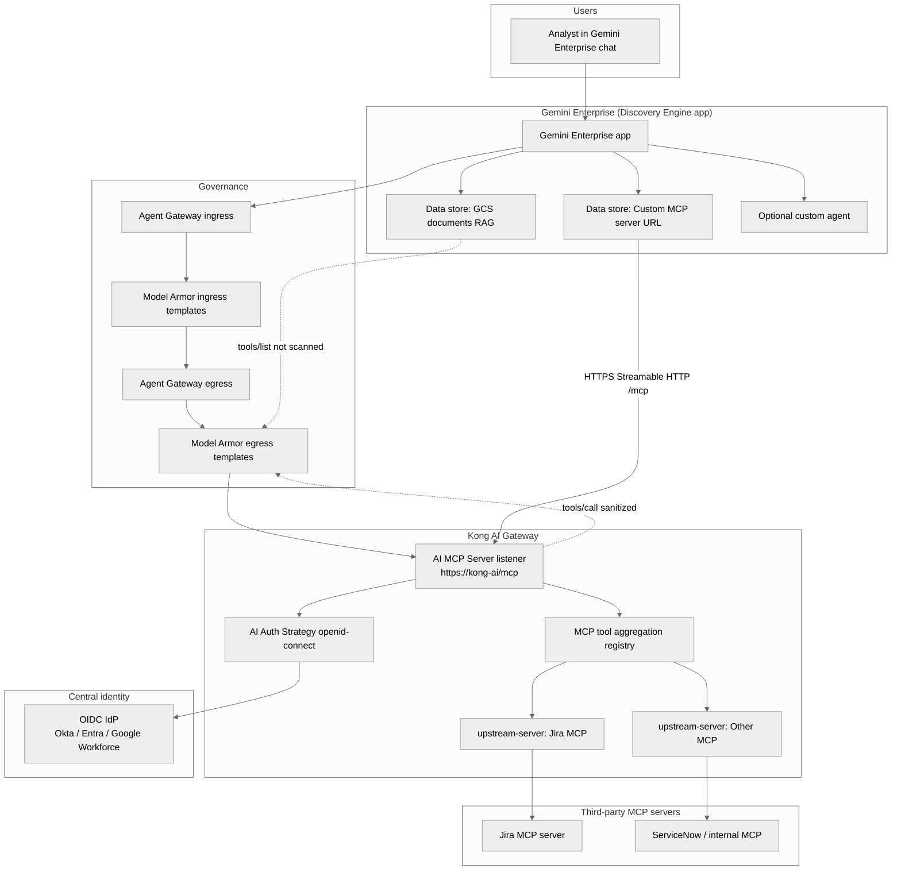
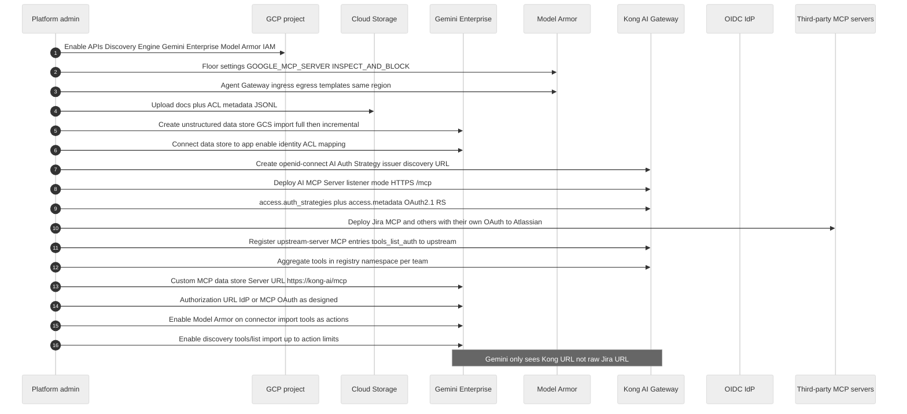
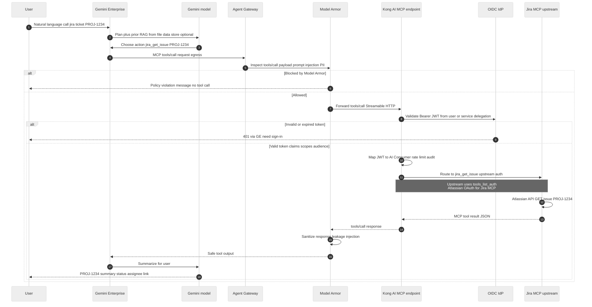
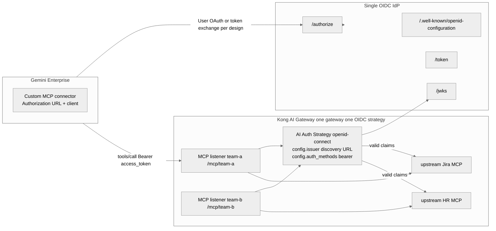
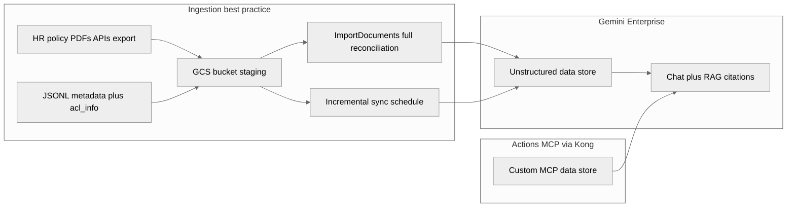
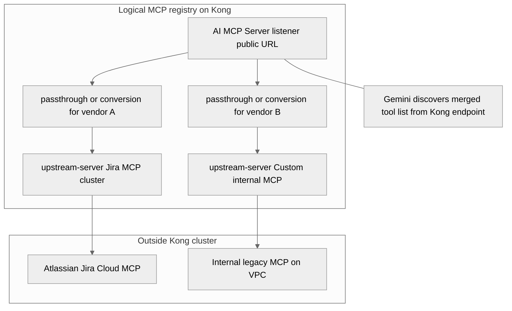
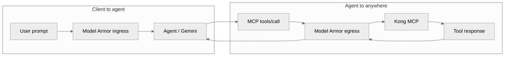

# Gemini Enterprise → Kong AI Gateway → MCP (Jira & third-party tools)

Architecture and setup flow for a **new Gemini Enterprise workload** with **discovery**, **Model Armor**, **file upload (RAG)**, and **Kong AI Gateway** as the MCP front door. Third-party MCP servers (Jira, ServiceNow, internal APIs) sit **behind** Kong’s **MCP registry / passthrough** pattern. **Central OIDC** at Kong gives one identity path to many MCP servers and tools.

This doc is diagram-first. Terraform for Kong on AWS/GCP in this repo is separate ([VERTEX-KONG-AWS-IRSA-WIF.md](VERTEX-KONG-AWS-IRSA-WIF.md)).

**GCP workload:** use the dedicated **`gfg`** project ([DESIGN-WORKLOAD-GFG.md](DESIGN-WORKLOAD-GFG.md), Terraform [tfe-workspace/workloads/gfg/](../tfe-workspace/workloads/gfg/)). Enable in [tfe-workspace/envs/dev/workload-gfg.tf](../tfe-workspace/envs/dev/workload-gfg.tf) (`enabled = true`). All resources and methods: [workloads/gfg/README.md](../tfe-workspace/workloads/gfg/README.md).

---

## Reference docs (pull latest before build)

| Area | Google / Kong doc |
|------|-------------------|
| Gemini Enterprise quickstart & data stores | [Get started with Gemini Enterprise](https://cloud.google.com/gemini/enterprise/docs/quickstart-gemini-enterprise) |
| Custom MCP server connector | [Set up custom MCP server data store](https://cloud.google.com/gemini/enterprise/docs/connectors/custom-mcp-server/set-up-custom-mcp-server) |
| File upload / GCS / RAG | [Prepare data for custom data sources](https://cloud.google.com/gemini/enterprise/docs/connectors/prepare-data), [Create custom connector](https://cloud.google.com/gemini/enterprise/docs/connectors/create-custom-connector) |
| MCP discovery & Agent Registry | [Google Cloud MCP overview](https://cloud.google.com/mcp/overview) |
| Model Armor on Agent Gateway | [Configure Model Armor on a gateway](https://cloud.google.com/gemini-enterprise-agent-platform/govern/configure-model-armor) |
| Model Armor floor settings (MCP) | [Integrate Model Armor with MCP](https://cloud.google.com/model-armor/model-armor-mcp-google-cloud-integration) |
| Kong OIDC | [OpenID Connect with AI Gateway 2.0](https://developer.konghq.com/ai-gateway/openid-connect/) |
| Kong MCP servers | [AI MCP Server entity](https://developer.konghq.com/ai-gateway/entities/ai-mcp-server/) |
| Kong auth strategies | [AI Auth Strategies](https://developer.konghq.com/ai-gateway/entities/ai-auth-strategy/) |

---

## Best-practice checklist (must-haves)

| Requirement | What to do |
|-------------|------------|
| **Discovery enabled** | Register MCP servers in **Agent Registry** (GCP) and/or expose `tools/list`, `prompts/list`, `resources/list` through Kong so Gemini can import tools as **actions** (custom MCP store supports Streamable HTTP only, HTTPS, often `/mcp`). |
| **Model Armor** | Enable on **Agent Gateway** (ingress + egress). Set **floor settings** for Google MCP with `INSPECT_AND_BLOCK` on `tools/call` and `prompts/get` payloads. |
| **File upload / RAG** | Production: stage docs in **GCS**, create Discovery Engine **data store**, initial **full reconciliation**, then **incremental** sync; enable **ACL** if docs are sensitive (`aclEnabled: true` + metadata). |
| **Kong MCP endpoint** | One HTTPS MCP URL per environment (e.g. `https://kong-ai.example.com/mcp`) — Gemini Enterprise custom MCP **Server URL** points here, not directly to Jira. |
| **MCP registry + third-party servers** | Kong **listener** / **passthrough-listener** / **upstream-server** modes: registry aggregates tools; upstream MCP servers (Jira MCP, etc.) registered behind Kong. |
| **Central OIDC** | Single **openid-connect** AI Auth Strategy on Kong (one IdP per gateway); attach to each MCP server via `access.auth_strategies`; use `access.metadata` for OAuth 2.1 resource-server behavior (audience, protected-resource metadata). |

---

## High-level architecture



---

## Setup flow (greenfield workload)



---

## Chat example: “Call Jira ticket PROJ-1234”

What happens when the user types in **Gemini Enterprise chat**: *“Call Jira and get details for ticket PROJ-1234”* (or *“call jira number PROJ-1234”*).



**Discovery vs execution**

| MCP method | Model Armor | Used when |
|------------|-------------|-----------|
| `tools/list`, `prompts/list`, `resources/list` | Not sanitized | Gemini **discovers** Jira tool names and schemas |
| `tools/call`, `prompts/get` | **Sanitized** | User message triggers **execution** |
| Tool execution errors | Sanitized | Malicious MCP tool error text |

---

## Central OIDC at Kong (one IdP, many MCP servers)

Goal: users authenticate **once** (or SSO session); Kong validates **every** MCP call with the same **openid-connect** strategy; optional **per-tool** authorization via claims (groups, scopes).



### Kong OIDC configuration pattern

1. **Create one** `openid-connect` **AI Auth Strategy** per AI Gateway (Kong docs: do not mix multiple OIDC providers on the same gateway).
2. Set `config.issuer` to your IdP discovery URL (Okta, Microsoft Entra, Google Workforce, etc.).
3. For each **AI MCP Server** in `conversion-listener`, `listener`, or `passthrough-listener` mode:
   - Set `access.auth_strategies: [<strategy name>]`.
   - Set `access.metadata` when you need **OAuth 2.1 resource server** behavior (protected resource metadata, **audience** validation for MCP clients).
4. **Upstream** Jira MCP: authenticate separately with `config.server.tools_list_auth` (Atlassian OAuth/API token) — this is **service-to-service**, not the end-user OIDC token.

### Gemini Enterprise ↔ Kong auth (two layers)

| Layer | Who | Typical mechanism |
|-------|-----|-------------------|
| **User → Gemini → Kong** | Human analyst | OIDC: Gemini custom MCP store **Authorization URL** + OAuth client; user consents; GE sends Bearer on MCP calls |
| **Kong → Jira MCP** | Platform | Upstream credentials, mTLS, or Atlassian OAuth on MCP server |
| **Optional service account** | Batch / agent | Client credentials or WIF-style token if your IdP supports it for non-interactive agents |

---

## File upload path (RAG) alongside MCP tools

Documents and **live tools** are separate data stores in Gemini Enterprise; both attach to the same app.



**Practice:** initial **full** sync from GCS, then **incremental** for changes; enable **ACL** on the data store so chat only retrieves files the user may read ([identity mapping](https://cloud.google.com/gemini/enterprise/docs/identity)).

---

## Kong MCP registry: where third-party servers live



| Kong MCP mode | Role |
|---------------|------|
| **listener** | Public MCP HTTP entry; OIDC on `access.auth_strategies` |
| **passthrough-listener** | Forward MCP to one upstream with minimal conversion |
| **upstream-server** | Defines remote MCP URL + **tools_list_auth** for discovery calls |
| **conversion-listener** | Normalize non-standard MCP for Gemini Streamable HTTP |

Register each third-party MCP once; expose **one** (or few) URLs to Gemini Enterprise.

---

## Model Armor placement (required)



**Floor setting example (project-wide MCP minimum):**

```bash
gcloud model-armor floorsettings update \
  --full-uri='projects/PROJECT_ID/locations/global/floorSetting' \
  --enable-floor-setting-enforcement=TRUE \
  --add-integrated-services=GOOGLE_MCP_SERVER \
  --google-mcp-server-enforcement-type=INSPECT_AND_BLOCK \
  --enable-google-mcp-server-cloud-logging
```

Also attach **ingress/egress templates** on **Agent Gateway** in the **same region** as templates ([configure Model Armor on a gateway](https://cloud.google.com/gemini-enterprise-agent-platform/govern/configure-model-armor)).

---

## Suggested naming for a new workload

| Component | Example name |
|-----------|----------------|
| GCP project | `gemini-ent-prod` |
| Gemini app | `enterprise-assistant-prod` |
| GCS staging | `gs://gemini-ent-docs-prod/` |
| Kong MCP URL | `https://kong-ai.company.com/mcp/enterprise` |
| OIDC audience | `mcp://kong-ai/enterprise` (match `access.metadata`) |
| Jira upstream | `jira-cloud-mcp` behind `upstream-server` |

---

## Security summary

- **Gemini** never holds Atlassian admin keys; **Jira MCP** does, scoped minimally.
- **Users** never call Jira MCP directly; all traffic **Kong + Model Armor**.
- **OIDC** centralizes **who** can invoke MCP; Kong **AI Consumer** mapping enables audit and rate limits.
- **Discovery** (`tools/list`) is allowed without payload sanitization — still restrict **network** access to Kong and **register** only trusted upstream MCP servers.

---

## Next steps in this repo (optional)

- Reuse Kong on EKS patterns from [VERTEX-KONG-AWS-IRSA-WIF.md](VERTEX-KONG-AWS-IRSA-WIF.md) for **Google token to Vertex**; add **separate routes** for **MCP listener** (different plugin chain: OIDC + MCP, not Vertex WIF).
- Add Terraform modules for Kong `AI MCP Server` + `AI Auth Strategy` when Kong config is codified.

---

## Quick test matrix

| Test | Pass criteria |
|------|----------------|
| Discovery | `tools/list` via Kong returns Jira + other tools |
| OIDC | Missing Bearer → 401; valid JWT → 200 on `tools/call` |
| Model Armor | Prompt injection in tool args blocked on egress |
| RAG | Uploaded GCS doc cited in chat; ACL user B cannot see user A doc |
| Jira E2E | Chat “PROJ-1234” returns issue JSON summarized correctly |
